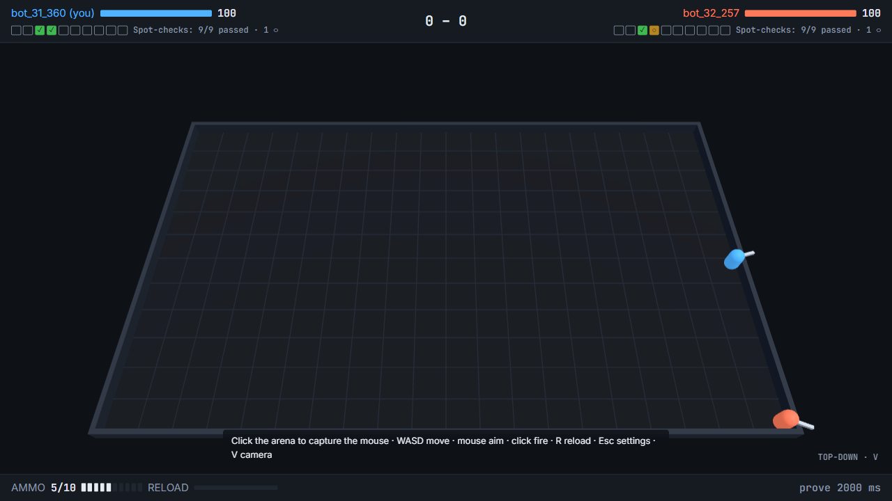
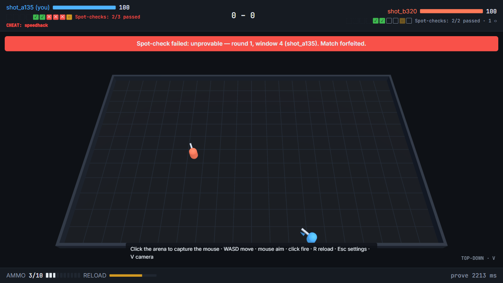

# ZK-Duel

ZK-Duel is a 1v1 browser shooter in which each player proves, with zk-SNARKs, that they followed the game rules (movement speed, turn rate, fire rate, ammo and reload) without revealing their hidden weapon state. Every window of 60 ticks is committed. The server spot-checks random windows live; the client proves each one in a Web Worker (Groth16, circom + snarkjs) while the game keeps running. After the match, every remaining window is proven in an audit, so a match is **AUDITED CLEAN** only when every window of both players has verified. ZK-Duel is the research prototype for the seminar *"Zero-Knowledge Proofs for Verifiable Fair-Play in Competitive Gaming and Esports"* (CSC301, The NorthCap University, 2026). It is built to produce measured evidence, and it is not a production anti-cheat system.

| Honest play: spot-checks ✓ on the proof strip | Speedhack in a strict room: the next spot-check fails |
|---|---|
|  |  |

## Key results

One mid-range laptop (Intel Core 5 210H, 16 GB, AC power). Full tables and conditions: [`bench/RESULTS.md`](bench/RESULTS.md) and [`docs/REPORT.md`](docs/REPORT.md).

| | Result |
|---|---|
| Groth16 prove, 1-s window (N = 60, 32,748 constraints), Chrome | **1.25 s** (p50); Node 1.15 s |
| Groth16 verify | **7 ms** (p50 7.2 ms), the same for every window size |
| Groth16 proof size | **723 B** |
| PLONK vs Groth16, same circuit | **170–320× slower** to prove: minutes per window, so not usable live |
| Rule-breaking cheat runs (speedhack, rapid-fire, infinite ammo, snap-aim) | **124/124** ended `audited_failed` (caught live, by the audit, or both) |
| Live catch rate, a cheat lasting one window (m = 1) | **85 %** (34/40); 100 % for m ≥ 5. Median live detection latency 4.5 s |
| Smooth aimbot (stays within the rules) | 11/11 `audited_clean`: the proof cannot see input provenance |
| Frame time while proving | p95 7.1 ms (2D) / 13.9 ms (3D), within the 20 ms target |

## Quick start

Needs Node 22 LTS (`fnm use 22`), Chrome, and circom 2.2.x on PATH for the one-time circuit build.

```bat
git clone https://github.com/Shivansh22Saroha/zk-duel.git
cd zk-duel
npm install
copy server\.env.example server\.env
copy client\.env.example client\.env
npm run circuits:build
npm run demo
```

`npm run demo` checks Node and the circuit artefacts, rebuilds the client if needed, starts the server (strict enforcement, dev cheats on) and prints the URLs:
- `http://localhost:5173/`: you
- `http://localhost:5173/?bot=7`: a bot opponent in a second window
- `http://localhost:5173/bench`: benchmark charts

The cheat drawer is on **F9**. The full 5-minute demo, with exact clicks and fixes for common problems, is in [`docs/DEMO.md`](docs/DEMO.md). Everything runs offline once the circuits are built.

## Project structure

```
zk-duel/
├── shared/     constants.ts (every rule number), sim.ts (the rules, once), protocol, Poseidon helpers
├── client/     Vite + TypeScript game: Canvas 2D / Three.js renderer, input, HUD, proof Web Worker, /bench
├── server/     Fastify REST + ws game server, spot-check scheduler, verifier worker pool, SQLite
├── circuits/   window.circom + templates, build scripts (compile, ptau, setup), circuit tests
├── bench/      Node benchmark runner, CSV export, RESULTS.md, out/ (CSV, charts, screenshots)
├── scripts/    demo.mjs (npm run demo)
└── docs/       specs, report sections, demo runbook
```

## Documentation

[`docs/`](docs/) holds the specification: [PRD](docs/PRD.md), [architecture and circuit design](docs/ARCHITECTURE.md), [API](docs/API_SPEC.md), [security and threat model](docs/SECURITY.md), [testing](docs/TESTING.md), [tech stack](docs/TECH_STACK.md), [environment](docs/ENVIRONMENT.md), [UI/UX](docs/UI_UX_SPEC.md), [database](docs/DATABASE_SCHEMA.md), [features](docs/FEATURES.md), [user flows](docs/USER_FLOWS.md) and [deployment](docs/DEPLOYMENT.md). It also has the [report sections](docs/REPORT.md), the [demo runbook](docs/DEMO.md), the [changelog](docs/CHANGELOG.md), the [TODO](docs/TODO.md) and the [v1.0.1 audit](docs/AUDIT_v1.0.1.md).

## Limitations

- A proof shows that the inputs obeyed the rules, not that a human produced them: a smooth aimbot passes.
- The Groth16 phase-2 setup is a single local contribution, and the circuit checks arena bounds only (no walls or obstacles).
- Proving is slower than play, so the guarantee is spot-checks plus a post-match audit, measured on one laptop only. All ten limitations are in [`docs/REPORT.md`](docs/REPORT.md#2-limitations).

## Licence

MIT, see [`LICENSE`](LICENSE). Built by Shivansh Saroha for the CSC301 Seminar, The NorthCap University, under the supervision of Ms. Vandana. Third-party packages keep their own licences: snarkjs and circomlib are GPL-3.0, and the bundled Inter and JetBrains Mono fonts are SIL OFL 1.1.

---

<details>
<summary><b>Full setup (circuits, environment, database)</b></summary>

Prerequisites: Node.js 22 LTS (`winget install Schniz.fnm`, `fnm install 22`) and npm 10+; circom 2.2.x (prebuilt binary, or Rust + `cargo install`); circomspect (`cargo install circomspect`) for `circuits:lint`; ~2 GB free disk; Chrome.

```bat
fnm use 22
npm install
:: groth16_60 (played) + groth16_4 (integration tests); groth16_30 is used by the browser bench
npm run circuits:build
npm run circuits:build -- --n 30
:: Optional: all 6 benchmark variants. PLONK needs the ptau-21 file, ~8 GB of zkeys and hours of setup
npm run circuits:build -- --all
copy server\.env.example server\.env
copy client\.env.example client\.env
npm run db:migrate
```

Development with hot reload: `npm run dev` (server :8080, client :5173). LAN play: `npm run dev:lan` and add `http://<host-ip>:5173` to `ALLOWED_ORIGINS` in `server\.env`. Keep both player windows visible (browsers throttle hidden tabs). The proving key (≈ 35 MB) downloads while you queue, is SHA-256-checked, and is cached on `localhost`/https. Keep the results page open after a match until the audit finishes.

</details>

<details>
<summary><b>Benchmarks</b></summary>

Measure only on AC power with the Windows **Performance** scheme (not "Silent"), other heavy apps closed, and no file edits during a run. `BENCH_TOKEN` must be set in `server\.env`.

```bat
:: terminal 1
npm run perf:serve
:: terminal 2
npm run bench:node -- --variants groth16_30,groth16_60,groth16_120 --upload
npm run bench:node -- --variants plonk_30,plonk_60 --plonk-warmups 1 --plonk-samples 5 --upload
npm run bench:browser -- --variants groth16_30,groth16_60,groth16_120
npm run bench:export
npx tsx bench/tables.ts
npm run bench:browser -- --export-only
npm run screenshots
```

Dashboard: `http://localhost:5173/bench`. Seminar runs and their conditions: [`bench/RESULTS.md`](bench/RESULTS.md).

</details>

<details>
<summary><b>All scripts</b></summary>

| Script | Does |
|---|---|
| `npm run demo` | Viva demo: checks, build if stale, production server (strict, dev cheats), prints the URLs |
| `npm run demo:reset` | Back the DB up to `server/data/backup-<date>.db` and start a fresh one (benchmark runs kept) |
| `npm run demo:rehearse` | Walk through docs/DEMO.md in Chrome and time each step (needs `npm run demo`) |
| `npm run offline:check` | Bot match + results + /bench with all non-local traffic blocked (needs `npm run demo`) |
| `npm run dev` / `dev:lan` | Server + client with hot reload (LAN: client exposed) |
| `npm run perf:serve` | Production `--mode perf` build + `vite preview` + server (for perf/E2E runs) |
| `npm test` | Unit + circuit tests |
| `npm run test:int` | Server integration tests (real sockets, bot matches, N = 4 proving; ≈ 15–20 min) |
| `npm run test:e2e` | Browser E2E: `e2e:cheats` then `e2e:audit-reload` (needs `npm run perf:serve`) |
| `npm run typecheck` / `lint` / `format:check` | Static checks |
| `npm run bots -- --matches N` | Bot matches against a running server; writes tick logs |
| `npm run perf:frame` / `perf:prove` / `perf:match` | Frame time, browser proving, full browser match measurements |
| `npm run exp:detect -- --reps 10` / `exp:browser` | Detection experiment (Node bots / one browser run per cheat) |
| `npm run circuits:build` | Compile + ptau + setup + info.json (`-- --n 30`, `-- --all`) |
| `npm run circuits:prove-log` / `circuits:mutate-log` | Prove a tick log offline / make a cheating copy of one |
| `npm run circuits:lint` | circomspect on the generated main circuits |
| `npm run bench:node` / `bench:browser` / `bench:export` | Benchmarks |
| `npm run db:migrate` | Apply SQL migrations |

</details>
